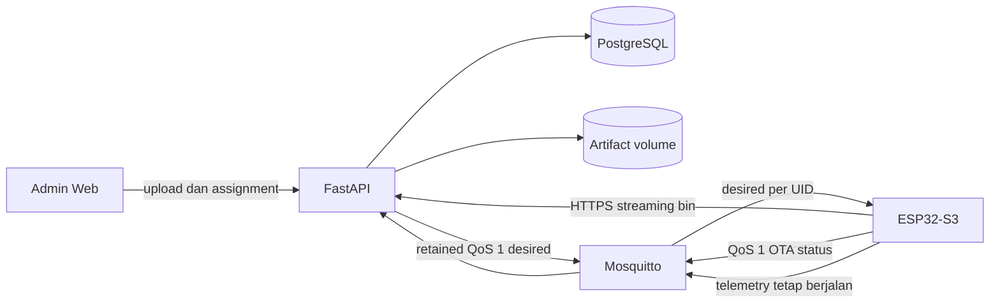

# Rencana Implementasi OTA Firmware AquaNotes

Status dokumen: **rencana yang telah diimplementasikan**; hasil produksi dicatat di `OTA-Implementation.md`.
Tanggal peninjauan: **5 Oktober 2026**.
Target perangkat: **ESP32-S3 AquaNotes Triangle**.
Prinsip utama: sederhana, dapat dipulihkan, kompatibel dengan sistem aktif, dan aman untuk perangkat yang berada jauh dari teknisi.

## 1. Ringkasan keputusan

OTA AquaNotes sebaiknya menggunakan komponen produksi yang sudah ada:

- **MQTT** sebagai control plane untuk perintah update dan laporan status.
- **HTTPS** sebagai data plane untuk mengunduh file firmware `.bin`.
- **PostgreSQL** untuk metadata release, target perangkat, dan histori proses OTA.
- **Admin Web AquaNotes** untuk upload, canary, pemantauan, pembatalan, dan rollout.
- **Partisi A/B ESP32** untuk tetap menyimpan firmware lama selama firmware baru diuji saat boot.

Tidak perlu membuat broker, microservice OTA, object storage, atau domain baru. Endpoint file dapat memakai domain aplikasi yang telah tersedia:

`https://aquanotes.farlabs.my.id/api/ota/...`

Domain MQTT tetap:

`mqtt.farlabs.my.id` melalui WSS port `443`, path `/mqtt`.

Identitas perangkat OTA harus menggunakan **`devices.uid`** seperti `AER2023AQ0029`, bukan MAC address. UID sudah menjadi identitas publik perangkat, username MQTT, dan pengikat ACL saat ini.

## 2. Kondisi aktual dan koreksi terhadap rencana lama

### 2.1 Komponen yang sudah siap dipakai

| Komponen | Kondisi sekarang | Implikasi OTA |
|---|---|---|
| ESP32-S3 + PlatformIO/Arduino | Firmware aktif menggunakan MQTT WSS dan sertifikat CA | OTA dapat memakai koneksi Wi-Fi/TLS yang sama, tetapi file diambil lewat HTTPS |
| Flash 8 MB | Toolchain menyediakan `otadata`, `ota_0`, dan `ota_1` | Mendukung application OTA dua slot; layout harus dipakukan di repo agar tidak bergantung pada default board |
| Mosquitto | Autentikasi unik per UID dan ACL topik telemetry | ACL dapat diperluas khusus topik OTA tanpa membuka akses lintas perangkat |
| FastAPI | Sudah menjadi MQTT consumer dan API aplikasi | Tambahkan fungsi OTA ke aplikasi yang sama; belum perlu service terpisah |
| PostgreSQL | Sumber kebenaran production | Simpan release, assignment, status, dan event OTA secara transaksional |
| Admin Web | Sudah mempunyai halaman fleet/device | Tambahkan tab Firmware/OTA pada admin yang sama |
| Cloudflare Tunnel | Web/API dan MQTT WSS sudah publik | Tidak perlu port-forward atau layanan berlangganan tambahan |

### 2.2 Hal yang perlu diubah dari rancangan sebelumnya

1. **Jangan memakai `mac_address` sebagai primary key.** Gunakan foreign key ke `devices.id`, sedangkan alamat perangkat yang terlihat operator tetap `devices.uid`.
2. **Jangan menjadikan polling HTTP tiga jam sebagai mekanisme utama.** Retained MQTT QoS 1 membuat perangkat yang sedang offline menerima target update setelah tersambung kembali.
3. **Gunakan SHA-256, bukan MD5.** SHA-256 memeriksa integritas artifact. Perlu dicatat bahwa hash saja bukan bukti keaslian; tanda tangan firmware dibahas pada hardening.
4. **Jangan menambahkan logika motor/relay.** Perangkat AquaNotes saat ini adalah perangkat sensor. Saat OTA cukup jeda pembacaan/pengiriman sensor, pertahankan LCD dan watchdog, lalu unduh firmware.
5. **Laporan sukses bukan sekadar `setup()` berhasil berjalan.** Firmware baru harus melewati self-test singkat, menandai image valid, lalu melapor. Reset sebelum validasi harus memicu rollback.
6. **Jangan memperbarui bootloader atau partition table melalui OTA v1.** Application OTA A/B aman terhadap putus daya ketika download; pembaruan bootloader/partition table tidak memiliki perlindungan yang sama.

## 3. Sasaran dan batasan

### 3.1 Sasaran wajib

- Perangkat tetap menjalankan firmware lama jika download gagal, file rusak, Wi-Fi terputus, atau listrik mati saat download.
- Firmware baru otomatis di-rollback jika gagal boot atau reset sebelum dinyatakan sehat.
- Update dapat diarahkan ke satu UID, beberapa UID, lalu seluruh fleet secara bertahap.
- Perangkat tidak boleh mengunduh release yang tidak ditugaskan kepadanya.
- Status dapat diaudit: siapa mengunggah, siapa menugaskan, versi asal/tujuan, hasil, waktu, dan kode error.
- Telemetry HTTPS lama dan MQTT tetap kompatibel; kontrak sensor/mobile/web yang ada tidak berubah.
- Sensor yang tidak terpasang atau bernilai `null` bukan alasan menggagalkan OTA.
- NTP tidak menjadi prasyarat OTA. Firmware tetap memakai seed waktu build dan sinkronisasi NTP oportunistik untuk TLS sebagaimana pola saat ini.

### 3.2 Di luar OTA v1

- Delta/binary patch OTA.
- Kubernetes, OTA microservice terpisah, S3/R2/MinIO, atau CDN khusus.
- Update bootloader, partition table, NVS, atau filesystem melalui dashboard.
- Rollout serentak ke seluruh perangkat tanpa canary.
- Anti-rollback eFuse.
- Secure Boot dan Flash Encryption sebelum prosedur signing, backup key, recovery, dan perangkat uji korban terbukti.

## 4. Arsitektur target



Pemisahan ini disengaja:

- MQTT cocok untuk perintah kecil, status, perangkat offline, dan delivery QoS 1.
- HTTPS cocok untuk file biner berukuran megabyte, streaming, timeout, dan validasi ukuran/hash.
- File `.bin` tidak dikirim sebagai payload MQTT.

## 5. Kontrak MQTT OTA

### 5.1 Topik

| Arah | Topik | Retain | QoS |
|---|---|---:|---:|
| Backend ke device | `devices/{uid}/ota/desired` | Ya | 1 |
| Device ke backend | `devices/{uid}/ota/status` | Tidak | 1 |
| Device ke backend | `devices/{uid}/telemetry` | Tidak | 1 |

Retained desired state berarti perangkat yang offline tetap mendapatkan target terbaru ketika reconnect. Ketika assignment selesai atau dibatalkan, backend menerbitkan retained payload kosong atau desired state `idle` agar perintah lama tidak dijalankan lagi.

### 5.2 Desired payload versi 1

```json
{
  "schema": 1,
  "assignment_id": 481,
  "release_id": 12,
  "version": "2.1.0",
  "url": "https://aquanotes.farlabs.my.id/api/ota/artifacts/12",
  "download_token": "opaque-random-token",
  "sha256": "64-lowercase-hex-characters",
  "size": 1392848,
  "mandatory": false
}
```

Aturan device:

- Abaikan `schema` yang tidak didukung dan laporkan `UNSUPPORTED_MANIFEST`.
- Cocokkan UID dari topik dengan UID firmware melalui ACL; UID tidak perlu ada di payload.
- Jangan downgrade jika versi target sama atau lebih rendah, kecuali assignment dicatat backend sebagai rollback manual.
- `assignment_id` menjadi kunci idempotensi. Pesan retained yang sama tidak boleh memulai download kedua setelah sukses.
- `download_token` adalah token acak per assignment, berlaku sampai assignment sukses, dibatalkan, kedaluwarsa, atau diganti. Backend hanya menyimpan hash token.

### 5.3 Status payload versi 1

```json
{
  "schema": 1,
  "message_id": "AER2023AQ0029-481-7",
  "assignment_id": 481,
  "running_version": "2.0.0",
  "target_version": "2.1.0",
  "state": "downloading",
  "progress": 42,
  "error_code": null
}
```

Nilai `state` yang didukung:

`assigned`, `deferred`, `downloading`, `downloaded`, `rebooting`, `pending_verify`, `success`, `failed`, `rolled_back`, `cancelled`.

`message_id` wajib unik agar QoS 1 yang terkirim ulang dapat diproses idempoten. Backend menetapkan waktu terima server; timestamp dari device tidak menjadi sumber kebenaran.

### 5.4 ACL Mosquitto yang diperlukan

```text
user aquanotes-backend
topic read devices/+/telemetry
topic read devices/+/ota/status
topic write devices/+/ota/desired
topic read $SYS/broker/#

pattern write devices/%u/telemetry
pattern write devices/%u/ota/status
pattern read devices/%u/ota/desired
```

Perangkat tidak boleh publish desired, membaca desired perangkat lain, atau membaca status perangkat lain.

## 6. Penyimpanan data

### 6.1 `firmware_releases`

| Field | Aturan |
|---|---|
| `id` | Primary key internal |
| `version` | SemVer unik, tanpa awalan wajib `v`; contoh `2.1.0` |
| `status` | `draft`, `ready`, `retired` |
| `artifact_path` | Path internal yang dibuat server, bukan nama file dari pengguna |
| `sha256` | 64 karakter hex, dihitung backend dari file tersimpan |
| `size_bytes` | Harus lebih kecil dari ukuran slot OTA |
| `release_notes` | Ringkasan perubahan dan risiko |
| `created_by` | FK ke admin uploader |
| `created_at` | Waktu server |

Artifact yang sudah `ready` bersifat immutable. Versi, file, hash, dan ukuran tidak boleh diedit. Jika binary berubah, buat release baru.

### 6.2 `device_ota_assignments`

| Field | Aturan |
|---|---|
| `id` | Primary key dan idempotency key bagi device |
| `device_id` | FK ke `devices.id`; bukan MAC |
| `release_id` | FK ke `firmware_releases.id` |
| `from_version` | Versi yang dilaporkan saat assignment dibuat |
| `state` | State machine OTA |
| `progress` | Nullable, 0 sampai 100 |
| `attempt_count` | Maksimum tiga percobaan otomatis |
| `download_token_hash` | SHA-256 token acak; plaintext tidak disimpan |
| `last_error_code` | Kode terkontrol, bukan log mentah |
| `last_error_detail` | Detail tersanitasi, dibatasi panjangnya |
| `requested_by` | FK admin |
| `requested_at`, `started_at`, `completed_at`, `last_report_at` | Waktu server |

Hanya satu assignment aktif per device. Pembuatan assignment baru harus membatalkan assignment lama dalam transaksi yang sama.

### 6.3 `device_ota_events`

Tabel append-only ringan untuk transisi status. Simpan `assignment_id`, `state`, `progress`, `error_code`, dan `created_at`. Tabel `audit_logs` yang sudah ada tetap digunakan untuk tindakan admin seperti upload, publish, assign, cancel, dan manual rollback.

Jangan menaruh password MQTT, token download plaintext, atau isi `secrets.h` dalam tabel/log OTA.

## 7. API backend

Semua endpoint admin memakai autentikasi dan role admin yang sudah ada.

| Method dan path | Fungsi |
|---|---|
| `POST /api/admin/ota/releases` | Upload `.bin` multipart sebagai `draft` |
| `GET /api/admin/ota/releases` | Daftar release dan ringkasan deployment |
| `POST /api/admin/ota/releases/{id}/publish` | Validasi lalu ubah `draft` menjadi `ready` |
| `POST /api/admin/ota/assignments` | Assign satu atau beberapa `device_id` ke release |
| `POST /api/admin/ota/assignments/{id}/cancel` | Batalkan assignment dan bersihkan retained desired |
| `GET /api/admin/ota/assignments` | Filter status, versi, UID, dan rentang waktu |
| `GET /api/ota/artifacts/{release_id}` | Streaming artifact setelah token assignment divalidasi |

Endpoint `/check` dan `/report` publik tidak dibutuhkan untuk v1 karena desired/status sudah memakai MQTT terautentikasi. Ini mengurangi dua kontrak device dan mencegah polling berkala.

### 7.1 Validasi upload

Backend wajib:

1. menolak ekstensi selain `.bin`;
2. menerapkan batas request sedikit di atas ukuran slot OTA;
3. menulis ke file sementara, menghitung SHA-256 sambil streaming, lalu atomic rename;
4. menolak file kosong atau lebih besar/equal dari slot target;
5. menghasilkan nama internal dari release ID/hash, bukan nama unggahan;
6. memastikan versi SemVer unik;
7. mencatat audit log tanpa isi credential;
8. tidak menyediakan artifact `draft` kepada device.

Validasi chip/image header dan kecocokan versi embedded sebaiknya dilakukan oleh release script. Backend tidak perlu menjadi parser firmware kompleks pada iterasi pertama.

### 7.2 Download artifact

- Gunakan streaming response; jangan memuat seluruh binary ke RAM.
- Wajib `Content-Length` yang tepat dan `Content-Type: application/octet-stream`.
- Hindari compression/content transformation pada route artifact.
- Token harus terikat ke `assignment_id`, UID, dan release.
- Terapkan rate limit per UID/IP, tetapi izinkan resume/retry yang wajar.
- Artifact disimpan pada volume host, misalnya `/srv/aquanotes-ota/artifacts`, dan ikut backup bersama metadata database.
- Untuk skala fleet sekarang, disk lokal cukup. Object storage baru dipertimbangkan jika jumlah release/fleet atau kebutuhan multi-node meningkat.

## 8. Perubahan firmware

### 8.1 Layout dan build yang deterministik

Tambahkan `partitions.csv` eksplisit ke repo dan referensikan dari `platformio.ini`. Jangan mengandalkan default board yang dapat berubah setelah upgrade platform.

Layout yang dipakai harus mempunyai:

- `otadata`;
- dua slot application, `ota_0` dan `ota_1`;
- slot berukuran sama dan lebih besar dari binary dengan margin minimal 20%;
- NVS/configuration yang tidak terhapus saat update application.

Toolchain saat ini menunjukkan layout 8 MB dengan dua slot sekitar `0x330000` byte. Nilai final harus dibuktikan dari artifact build dan dicatat dalam release checklist.

Versi firmware jangan lagi hanya hardcoded sebagai `v2.0.0-MQTT`. Gunakan SemVer dari file/generated build flag dan sertakan short Git SHA pada metadata build, contoh:

`2.1.0+g1a2b3c4`

### 8.2 Struktur kode minimum

Karena `main.cpp` sudah besar, logika OTA dipisahkan hanya menjadi:

- `include/ota_update.h`
- `src/ota_update.cpp`
- hook kecil pada callback MQTT dan startup di `main.cpp`.

Tidak perlu framework state-machine baru. Gunakan enum state, queue FreeRTOS, dan satu task OTA agar callback MQTT tidak pernah menjalankan download blocking.

### 8.3 Alur perangkat

1. MQTT menerima desired payload, memvalidasi schema, versi, hash, ukuran, dan assignment.
2. Callback hanya menyalin command valid ke queue OTA.
3. Task OTA mengecek precondition:
   - Wi-Fi tersambung;
   - baterai minimal **50%** atau sumber daya eksternal terdeteksi;
   - RSSI minimal **-75 dBm**;
   - tidak sedang berada di menu/proses kalibrasi sensor;
   - ukuran artifact muat di next OTA partition.
4. Jika belum aman, laporkan `deferred` dan coba kembali dengan exponential backoff.
5. Jeda polling sensor dan publish telemetry selama flash write, tetapi biarkan LCD dan watchdog hidup.
6. LCD menampilkan `OTA`, persentase, dan kode singkat jika gagal.
7. Unduh HTTPS secara streaming langsung ke inactive OTA slot.
8. Validasi panjang dan SHA-256 sebelum memilih boot partition baru.
9. Laporkan `rebooting`, simpan assignment pending di NVS, lalu reboot.
10. Boot firmware baru masuk `pending_verify`, menjalankan self-test, lalu menandai image valid.
11. Publish `success`; jika broker belum tersambung, status pending tetap disimpan di NVS dan dikirim setelah reconnect.

OTA tidak boleh menunggu seluruh sensor valid dan tidak boleh menunggu NTP menjadi `OK`.

### 8.4 Self-test dan rollback

Self-test awal harus singkat, lokal, dan deterministik. Sukses jika:

- firmware dapat membaca NVS/secrets;
- task/queue inti berhasil dibuat;
- LCD dan main loop tidak crash;
- image metadata dapat dibaca;
- watchdog tidak reset selama jendela validasi sekitar 30 sampai 60 detik.

Jangan mensyaratkan Internet, MQTT, NTP, atau semua sensor RS485 sehat untuk menandai image valid. Gangguan jaringan/sensor bukan kerusakan firmware dan dapat menyebabkan rollback tanpa akhir.

Pada state `ESP_OTA_IMG_PENDING_VERIFY`:

- self-test sukses: panggil `esp_ota_mark_app_valid_cancel_rollback()`;
- kegagalan fatal: panggil API mark-invalid-and-reboot;
- reset/panic sebelum validasi: bootloader mengembalikan image sebelumnya.

Verifikasi pada baseline USB bahwa bootloader yang benar-benar diflash mempunyai rollback support. Konfigurasi source/toolchain saja belum cukup jika bootloader perangkat lama belum pernah diperbarui.

### 8.5 Retry dan kode error

Maksimum tiga percobaan otomatis per assignment, dengan backoff misalnya 1, 5, lalu 30 menit. Setelah itu status `failed` dan perlu retry manual dari admin.

Kode minimum:

| Kode | Arti |
|---|---|
| `LOW_BATTERY` | Baterai di bawah ambang |
| `WEAK_WIFI` | RSSI di bawah ambang |
| `CALIBRATION_ACTIVE` | Kalibrasi sedang berjalan |
| `UNSUPPORTED_MANIFEST` | Schema desired tidak dikenal |
| `VERSION_REJECTED` | Versi sama/downgrade tidak sah |
| `AUTH_FAILED` | Token artifact ditolak |
| `HTTP_TIMEOUT` | Download timeout |
| `SIZE_MISMATCH` | Panjang file tidak sesuai |
| `HASH_MISMATCH` | SHA-256 tidak sesuai |
| `NO_OTA_SLOT` | Layout/ruang flash tidak sesuai |
| `FLASH_WRITE_FAILED` | Penulisan OTA gagal |
| `SELF_TEST_FAILED` | Firmware baru gagal validasi |
| `ROLLED_BACK` | Bootloader kembali ke image lama |

Detail error pada Serial boleh lebih lengkap, tetapi status MQTT tidak boleh memuat password, token, atau URL lengkap yang mengandung token.

## 9. Keamanan

### 9.1 Baseline OTA v1

- TLS dengan validasi hostname dan CA; dilarang memakai mode insecure.
- MQTT username/password unik per UID yang sudah diterapkan.
- ACL topic per UID.
- Artifact hanya dapat diambil oleh assignment token acak.
- SHA-256 dan validasi ukuran setelah download.
- Admin RBAC dan audit log.
- Secret tidak masuk Git, log, response list, atau screenshot dashboard setelah provisioning.

SHA-256 membuktikan file yang diterima sama dengan manifest, tetapi **tidak membuktikan siapa yang membuat firmware** jika backend/broker ikut diambil alih.

### 9.2 Signing sebagai gate sebelum rollout luas

Sebelum OTA dipakai secara rutin pada seluruh site, tambahkan tanda tangan image. ESP-IDF mendukung verifikasi signed OTA tanpa langsung mengaktifkan Secure Boot. Ini memberi autentisitas artifact sambil mempertahankan jalur recovery USB.

Private signing key:

- hanya berada pada mesin build/CI yang dibatasi;
- tidak disimpan di repo, backend production, broker, atau firmware;
- mempunyai backup offline terenkripsi dan SOP rotasi/recovery;
- public verification key ditanam pada firmware baseline.

### 9.3 Secure Boot dan Flash Encryption

Keduanya layak untuk generasi produksi berikutnya, tetapi jangan diaktifkan ad hoc pada perangkat lapangan. Aktivasi melibatkan eFuse dan dapat membatasi recovery. Terapkan setelah signing pipeline, key custody, full-flash recovery, dan prosedur RMA diuji pada unit korban.

Anti-rollback eFuse belum diperlukan pada v1 karena operasi perlu dapat kembali ke known-good release. Pencegahan downgrade sementara cukup dilakukan oleh assignment backend dan perbandingan SemVer device.

## 10. Dashboard admin

Tambahkan satu area **Firmware / OTA** ke admin yang sudah ada, bukan aplikasi baru.

### 10.1 Halaman Releases

- upload `.bin`, version, dan release notes;
- tampilkan ukuran, SHA-256, uploader, waktu, dan status;
- tombol Publish setelah validasi;
- artifact ready tidak dapat diganti;
- release yang pernah dipakai hanya dapat di-retire, bukan dihapus.

### 10.2 Halaman Rollout

- pilih release dan daftar UID;
- filter berdasarkan online/offline, versi, tambak, dan kolam;
- tampilkan peringatan jika mencoba memilih semua device;
- batch canary yang eksplisit;
- progress berdasarkan state, bukan hanya persentase download;
- tombol pause batch, cancel perangkat yang belum mulai, dan retry failed;
- tombol rollback yang sebenarnya membuat assignment ke known-good release dan mencatat alasan.

Mobile app pengguna tidak perlu memiliki kontrol OTA. Pengguna boleh melihat versi/status di masa depan, tetapi fungsi administrasi dan release tetap eksklusif admin.

## 11. Tahapan implementasi konkret

### Tahap 0 — Bekukan baseline dan buktikan recovery

Pekerjaan:

- tag source firmware MQTT yang stabil sebagai known-good;
- pin versi PlatformIO platform/framework/library;
- tambahkan `partitions.csv` eksplisit;
- hasilkan full USB image dan application `.bin`;
- catat ukuran slot serta ukuran binary;
- lakukan backup credential per UID;
- uji flash kabel dan serial recovery pada satu unit meja.

Exit criteria:

- satu unit dapat diflash ulang dari kondisi firmware rusak;
- credential Wi-Fi/MQTT tetap dapat dipulihkan;
- kedua OTA slot terlihat dan bootloader rollback aktif.

Rollback tahap ini: flash kembali full image known-good lewat USB.

### Tahap 1 — Backend dan broker, tanpa mengirim command ke device

Pekerjaan backend:

- migration tiga tabel OTA;
- model dan schema additive;
- upload/publish/download API;
- token assignment hashed;
- MQTT consumer menerima `devices/+/ota/status` secara idempoten;
- publisher retained desired;
- artifact volume pada `deployment/stage2/compose.yml`;
- audit log dan automated tests.

Pekerjaan broker:

- backup ACL/password file;
- tambahkan ACL OTA;
- reload/restart broker;
- smoke test lintas UID untuk memastikan akses terlarang ditolak.

Exit criteria:

- telemetry production tetap masuk;
- upload dan download token teruji;
- backend dapat publish desired dummy dan menerima status dummy;
- device A tidak dapat membaca/menulis topik device B.

Rollback: deploy backend image sebelumnya dan pulihkan ACL. Migration hanya additive sehingga tabel OTA boleh tetap ada tanpa memengaruhi kontrak lama.

### Tahap 2 — Firmware OTA pada unit meja

Pekerjaan:

- implementasi parser desired, queue, task OTA, HTTPS streaming, SHA-256, NVS pending report, dan status MQTT;
- implementasi pending-verify/self-test/mark-valid;
- buat versi `2.1.0-ota-baseline` untuk uji;
- update dokumentasi kode LCD/Serial.

Exit criteria mengikuti matriks pengujian pada bagian 12. Jangan mengunjungi site sebelum power-loss dan rollback test lulus.

### Tahap 3 — Dashboard dan signing

Pekerjaan:

- tambah UI release/rollout ke admin web;
- tambah build script yang menghasilkan binary, SHA-256, manifest, dan signature;
- backend memverifikasi artifact/manifest saat publish;
- firmware memverifikasi signature sebelum memilih boot partition.

Exit criteria:

- binary termodifikasi satu byte ditolak;
- private key tidak berada pada server/API/repo;
- operator lain dapat mengikuti release checklist tanpa langkah tersembunyi.

### Tahap 4 — Kunjungan baseline satu kali

Per perangkat:

1. pastikan UID dan credential cocok dengan inventory;
2. backup konfigurasi yang diperlukan;
3. flash full baseline via USB agar bootloader, partition table, dan application konsisten;
4. pastikan telemetry masuk;
5. pastikan device subscribe desired miliknya;
6. lakukan OTA no-op/test ke patch release;
7. catat hasil serta waktu kunjungan.

Jangan menonaktifkan jalur HTTPS telemetry lama hanya karena baseline OTA selesai. Dual-ingestion tetap menjadi kompatibilitas/rollback sampai MQTT dan OTA terbukti stabil.

### Tahap 5 — Canary dan fleet rollout

Urutan yang disarankan:

1. satu unit dummy di meja, observasi minimum 24 jam;
2. satu perangkat site yang paling mudah dijangkau, observasi 24 jam;
3. tiga sampai lima perangkat dari kondisi jaringan/site berbeda, observasi 48 jam;
4. batch 25% dengan jeda 24 jam;
5. sisa fleet setelah tidak ada indikator pause.

Jangan hardcode UID canary di backend; operator memilih dari dashboard.

Pause rollout otomatis/manual jika:

- ada satu rollback yang belum dijelaskan;
- dua kegagalan berurutan;
- rasio failed lebih dari 10% pada batch;
- telemetry hilang lebih dari dua interval setelah update;
- CPU/memori API, broker, atau error rate meningkat abnormal.

## 12. Matriks pengujian wajib

| Skenario | Hasil yang diharapkan |
|---|---|
| Update normal | Download, reboot, validasi, status success, telemetry kembali |
| Wi-Fi putus saat download | Image lama tetap boot; retry berbatas setelah reconnect |
| Listrik mati saat download | Image lama tetap boot; tidak brick |
| Listrik mati pada first boot | Bootloader rollback ke image valid sebelumnya |
| Binary/hash rusak | Ditolak sebelum boot partition diganti |
| Signature salah | Ditolak sebelum instalasi pada fase signing |
| HTTP lambat/timeout | Gagal terkontrol; MQTT dan firmware lama pulih |
| Baterai rendah | `deferred`, tidak memulai flash |
| Sensor tidak terpasang/null | OTA tetap dapat berjalan |
| Kalibrasi aktif | `deferred`, tidak mengganggu kalibrasi |
| Desired retained duplikat | Assignment tidak dieksekusi dua kali |
| Status QoS 1 duplikat | Satu event logis, tidak menggandakan state |
| Desired lama setelah versi sukses | Tidak downgrade/tidak download ulang |
| Device A memakai token/device B | HTTP 403 dan audit/rate-limit event |
| Device A akses topic device B | Ditolak ACL broker |
| Broker offline setelah first boot | Image dapat divalidasi lokal; success dikirim setelah reconnect |
| Semua sensor gagal | Tidak menyebabkan firmware rollback |
| Release sebelumnya di-assign manual | Rollback operasional tercatat dan berhasil |

Tes power-loss perlu dilakukan berkali-kali pada posisi acak selama download dan first boot, bukan hanya satu kali.

## 13. Release checklist operator

Sebelum publish:

- working tree bersih dan commit/tag diketahui;
- dependency/toolchain sesuai lock/pin;
- build release, bukan debug;
- version SemVer baru;
- ukuran binary memiliki margin minimal 20% dari slot;
- SHA-256 dan signature dihasilkan otomatis;
- release notes mencakup schema/config change;
- unit meja lulus regression sensor, MQTT, LCD, calibration, dan reboot;
- backup PostgreSQL dan artifact terbaru tersedia.

Sebelum setiap batch:

- known-good release masih tersedia;
- health API, broker, database, dan tunnel normal;
- perangkat target mempunyai `last_seen` wajar;
- tidak ada maintenance/calibration terjadwal;
- operator mengetahui lokasi perangkat dan kontak site;
- pause criteria dan rollback owner ditentukan.

Setelah batch:

- seluruh assignment mencapai terminal state;
- versi berjalan cocok;
- telemetry kembali dalam maksimal dua interval;
- tidak ada lonjakan reboot, offline, atau error sensor;
- event dan audit log lengkap.

## 14. Backup, retensi, dan observabilitas

- Backup harus mencakup **PostgreSQL dan artifact directory**. Backup salah satunya saja tidak cukup untuk recovery.
- Jangan hapus artifact yang masih menjadi current/target version perangkat mana pun.
- Pertahankan minimal dua known-good release terakhir dan seluruh artifact yang masih terpasang di fleet.
- Alert admin jika assignment `downloading` tidak berubah melewati timeout, perangkat tidak kembali setelah reboot, atau status `rolled_back` muncul.
- Ukur: jumlah perangkat per version, success rate, rollback rate, median download time, failure per error code, dan last report age.
- Log backend harus memakai assignment ID/UID dan tidak memuat token atau credential.

## 15. Perubahan file yang diperkirakan

### Backend `Aquanotes_FastAPI`

- `app/models.py`: tiga model OTA dan relasi ke `Device`.
- `app/schemas.py`: schema release, assignment, dan status.
- `app/routers/ota.py`: endpoint admin dan artifact streaming.
- `app/mqtt_consumer.py`: subscription status OTA dan idempotent handler.
- `app/ota_service.py`: hashing, storage, token, publish/clear retained desired.
- `app/main.py`: registrasi router.
- `deployment/stage2/compose.yml`: persistent artifact volume.
- `deployment/mosquitto/acl`: ACL OTA.
- `tests/`: API, state transition, token isolation, MQTT duplicate, dan ACL smoke tests.

### Web `Aquanotes-WebApps`

- route/tab admin Firmware;
- tipe API release/assignment;
- upload, publish, canary selection, progress, cancel/retry/rollback;
- jangan mengubah kontrak halaman pengguna/mobile.

### Firmware `Aquanotes_Frimware`

- `aquanotes-triangle/partitions.csv`;
- `platformio.ini`: pin toolchain dan partition file;
- `include/ota_update.h` dan `src/ota_update.cpp`;
- `src/main.cpp`: callback/queue hook, startup verification, dan LCD status;
- release script untuk version, build, size check, hash, manifest, dan signing.

## 16. Definition of Done

OTA baru dinyatakan production-ready jika seluruh syarat berikut terpenuhi:

- recovery USB dan credential restore terdokumentasi serta diuji;
- application A/B, pending verification, dan automatic rollback terbukti di hardware;
- power-loss test lulus;
- artifact memiliki HTTPS validation, SHA-256, ukuran, dan signature;
- ACL lintas UID dan token lintas assignment ditolak;
- seluruh operasi admin diaudit;
- canary nyata sukses dan stabil minimum 24 jam;
- telemetry, mobile app, web pengguna, kalibrasi, dan firmware lama tidak mengalami perubahan kontrak;
- operator mempunyai checklist, pause rule, serta known-good rollback release;
- tidak ada credential/private key di Git atau log.

## 17. Referensi teknis

- ESP-IDF OTA: <https://docs.espressif.com/projects/esp-idf/en/v5.5.4/esp32s3/api-reference/system/ota.html>
- ESP-IDF partition tables: <https://docs.espressif.com/projects/esp-idf/en/v5.5.4/esp32s3/api-guides/partition-tables.html>
- ESP-IDF security overview: <https://docs.espressif.com/projects/esp-idf/en/v5.5.4/esp32s3/security/security.html>

Dokumen implementasi berikutnya harus mencatat hasil uji nyata, hash artifact baseline, versi bootloader/toolchain, dan keputusan signing key. Jangan mengubah status dokumen ini menjadi selesai hanya karena API atau UI sudah dibuat; kelulusan hardware failure test adalah gate utama.
