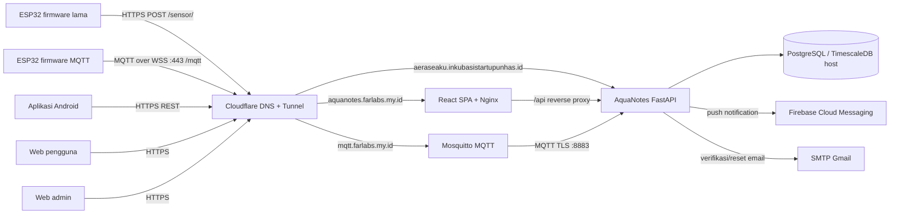
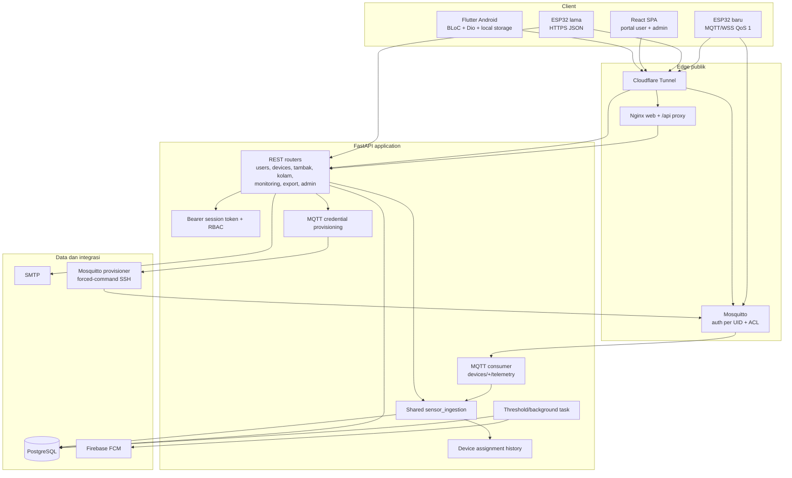
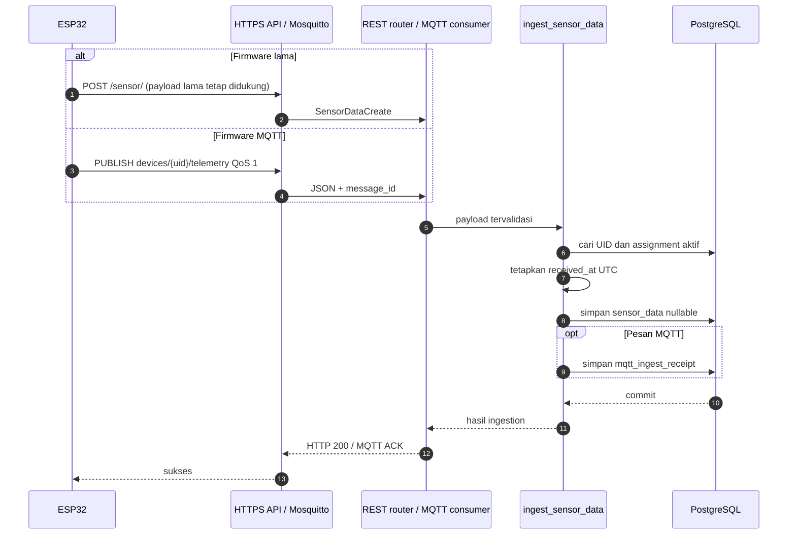
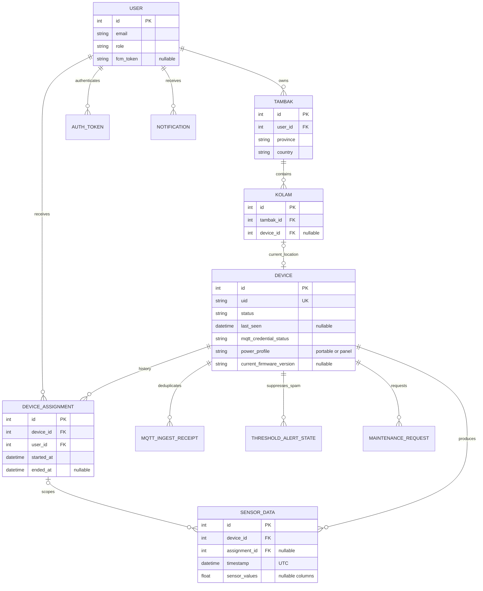
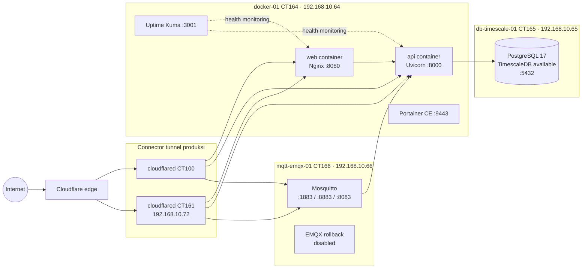
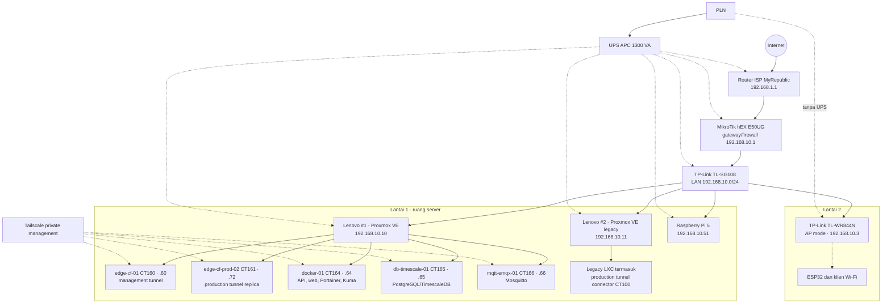

# Arsitektur AquaNotes

> Status: arsitektur produksi (*as-built*) per 5 Oktober 2026.
> Cakupan: firmware ESP32, aplikasi mobile, web pengguna/admin, backend, data, MQTT, dan infrastruktur tempat layanan produksi berjalan.

## 1. Ringkasan

AquaNotes adalah platform pemantauan kualitas air. ESP32 membaca sensor, backend menyimpan pembacaan dan mengevaluasi ambang, lalu pengguna memantau tambak/kolam melalui aplikasi Android atau web. Sistem saat ini memakai **dual-ingestion** selama transisi firmware:

- firmware lama tetap mengirim `POST /sensor/` melalui HTTPS;
- firmware baru mengirim MQTT QoS 1 ke `devices/{uid}/telemetry` melalui WSS;
- kedua kanal memakai fungsi ingestion dan tabel sensor yang sama;
- timestamp pengukuran ditetapkan backend dalam UTC; nilai waktu dari firmware lama tetap diterima untuk kompatibilitas tetapi tidak dijadikan sumber waktu;
- parameter sensor boleh `null`, sehingga sensor yang tidak dipasang atau gagal dibaca tidak menghentikan parameter lain.

PostgreSQL adalah sumber kebenaran produksi. Mosquitto adalah broker MQTT produksi. EMQX lama tetap terpasang dalam keadaan nonaktif hanya sebagai jalur rollback sementara.

## 2. Konteks sistem

## 3. Tech stack

| Lapisan | Teknologi utama | Peran |
|---|---|---|
| Firmware | ESP32-S3, C++/Arduino, PlatformIO, FreeRTOS task | Pembacaan sensor, LCD, provisioning Wi-Fi, pengiriman telemetri |
| Sensor/periferal | OneWire, DallasTemperature, ModbusMaster, Adafruit GFX/ILI9341 | Sensor suhu, sensor serial/Modbus, dan layar TFT |
| MQTT firmware | WebSockets, MQTTPubSubClient, TLS CA | MQTT 3.1.1 melalui WSS, publish QoS 1 |
| Mobile | Flutter/Dart, Flutter BLoC, Dio, GetIt, Hive/SharedPreferences | Aplikasi Android, autentikasi, monitoring, grafik, konfigurasi, ekspor |
| Mobile visualisasi | `fl_chart`, Syncfusion gauges | Grafik histori dan indikator parameter |
| Mobile notification | Firebase Messaging, Flutter Local Notifications | Push notification dan tampilan notifikasi lokal |
| Web | React 19, TypeScript 7, React Router 7, Vite 8 | Portal pengguna dan admin berbasis SPA |
| Web visualisasi | Recharts, Phosphor Icons | Grafik monitoring dan ikon UI |
| Web serving | Nginx 1.27 Alpine | Static SPA, fallback route, reverse proxy `/api` |
| Backend | Python 3.11, FastAPI 0.115, Uvicorn | REST API, autentikasi, bisnis perangkat/tambak/kolam |
| Validasi/ORM | Pydantic 2, SQLAlchemy 2, Psycopg 3 | Validasi kontrak dan akses database |
| MQTT backend | Paho MQTT 2 | Consumer telemetri MQTT QoS 1 |
| Database | PostgreSQL 17 pada host TimescaleDB 2.29 | Data transaksi dan time-series sensor; schema aplikasi masih relasional biasa |
| Broker | Eclipse Mosquitto | Autentikasi per perangkat, ACL topik, listener MQTT/TLS/WebSocket |
| Eksternal | Firebase Admin SDK, SMTP Gmail | Push notification, verifikasi email, reset password |
| Observability | Prometheus FastAPI Instrumentator, Uptime Kuma | Endpoint `/metrics`, health check, dan pemantauan availability |
| Packaging | Docker, Docker Compose, multi-stage image | Menjalankan API dan web produksi |
| Edge/network | Cloudflare Tunnel, Tailscale, MikroTik RouterOS | Ingress publik tanpa port-forward, administrasi privat, routing/firewall LAN |
| Virtualisasi | Proxmox VE, unprivileged LXC | Isolasi host edge, aplikasi, database, dan broker |
| Operasional | Portainer CE | Pengelolaan container Docker |

Versi pada tabel mengikuti manifest/release produksi saat dokumen dibuat. TimescaleDB tersedia pada host database, tetapi kode yang diperiksa belum menjadikan `sensor_data` sebagai hypertable; jangan mengasumsikan fitur Timescale dipakai sebelum migrasi schema khusus dilakukan.

## 4. Arsitektur software

### 4.1 Komponen dan dependensi

### 4.2 Jalur telemetri dual-ingestion

Aturan penting jalur ini:

1. `uid` harus sudah terdaftar pada tabel `devices`.
2. Device `maintenance` atau `inactive` tetap memperoleh respons kompatibel, tetapi pembacaan tidak disimpan.
3. MQTT mewajibkan `message_id`; tabel receipt mencegah duplikasi akibat redelivery QoS 1.
4. Nilai `suhu`, `ph`, `do`, `tds`, `ammonia`, dan `salinitas` independen dan nullable.
5. Waktu simpan berasal dari server. API lama masih menerima field `timestamp` agar firmware lama tidak rusak.
6. Database menyimpan UTC. API monitoring mengirim timestamp UTC ber-offset; ekspor dapat mengubahnya ke zona tambak berdasarkan provinsi Indonesia (WIB/WITA/WIT).

### 4.3 Domain dan model data utama

`DeviceAssignment` mempertahankan batas kepemilikan historis: saat device dilepas dan diklaim pengguna lain, data lama tetap terkait assignment lama. Ini mencegah histori pengguna sebelumnya ikut terlihat oleh pemilik baru.

### 4.4 Autentikasi dan otorisasi

- Mobile lama dan endpoint REST memakai opaque Bearer token yang disimpan pada tabel `auth_tokens`; ini bukan JWT.
- Web mendukung registrasi dengan verifikasi email, login, lupa/reset password, serta role `user` dan `admin`.
- Password pengguna di-hash dengan bcrypt/passlib.
- Reset password mencabut sesi lama.
- Firmware MQTT memakai username sama dengan UID dan password unik per perangkat.
- ACL Mosquitto membatasi perangkat agar hanya dapat menulis topik `devices/{username}/telemetry` miliknya.
- Admin membuat device/credential melalui backend; password plaintext hanya dikembalikan saat provisioning dan hash-nya dipasang pada broker melalui akun SSH terbatas.
- Rahasia runtime tidak berada di image: environment, Firebase JSON, CA, dan SSH key dipasang sebagai file/volume rahasia.

### 4.5 Notifikasi

Background task membaca data terbaru, membandingkannya dengan threshold per parameter, lalu membuat `Notification` dan mengirim FCM bila token tersedia. `ThresholdAlertState` menyimpan keadaan alert aktif agar pembacaan berulang tidak menghasilkan spam. Parameter bernilai `null` atau threshold yang dinonaktifkan tidak dievaluasi.

## 5. Arsitektur deployment

Compose produksi menjalankan satu container API dan satu container web. `START_BACKGROUND_TASKS=true` hanya boleh aktif pada satu instance API sampai background worker mempunyai mekanisme leader election atau dipisah menjadi worker tersendiri.

## 6. Infrastruktur fisik dan jaringan

### 6.1 Inventaris node inti AquaNotes

| Node | Bentuk | LAN | Tailscale | Fungsi AquaNotes |
|---|---|---:|---|---|
| `edge-cf-prod-02` | LXC CT161 | `192.168.10.72` | `100.120.195.127` | Replica connector tunnel produksi |
| `docker-01` | LXC CT164 | `192.168.10.64` | `100.125.123.107` | Container API, web, Portainer, Uptime Kuma |
| `db-timescale-01` | LXC CT165 | `192.168.10.65` | `100.97.236.43` | PostgreSQL/TimescaleDB |
| `mqtt-emqx-01` | LXC CT166 | `192.168.10.66` | `100.99.107.23` | Mosquitto produksi; nama host lama dipertahankan |
| `edge-cf-01` | LXC CT160 | `192.168.10.60` | `100.126.154.79` | Tunnel management, bukan origin aplikasi utama |

Connector produksi mempunyai replica pada dua hypervisor agar kegagalan satu connector tidak langsung memutus seluruh hostname. Origin aplikasi, database, dan broker masih berada pada satu Proxmox utama; jadi host fisik tersebut tetap merupakan *single point of failure* untuk layanan AquaNotes.

### 6.2 Port dan jalur akses

| Sumber | Tujuan | Port/protokol | Kebijakan |
|---|---|---|---|
| Internet | Cloudflare | HTTPS/WSS 443 | Publik |
| cloudflared | web | HTTP 8080 | LAN internal |
| cloudflared | API legacy | HTTP 8000 | LAN internal |
| cloudflared | Mosquitto WebSocket | HTTP 8083 | Origin WSS; TLS berakhir di Cloudflare |
| backend | Mosquitto | MQTT TLS 8883 | Service credential backend |
| backend | PostgreSQL | TCP 5432 | Role aplikasi khusus |
| admin | host internal | SSH/management | LAN atau Tailscale; tidak dipublikasikan |
| DBeaver admin | PostgreSQL | TCP 5432 | LAN/Tailscale sesuai ACL |

Tidak ada kebutuhan port-forward dari Internet ke Proxmox, database, SSH, Portainer, atau broker. Cloudflare Tunnel membuat koneksi keluar dari connector; administrasi privat memakai Tailscale.

## 7. Repository dan artefak

| Komponen | Lokasi kerja | Repository/artefak |
|---|---|---|
| Backend | `D:\Aerasea\Aquanotes_FastAPI` | `Frey210/Aquanotes_FastAPI` |
| Web | `D:\Aerasea\Aquanotes-WebApps` | Source React dan image `aquanotes-web` |
| Mobile | `D:\Aerasea\aquanotes-mobile-app` | `MTC-Hi-Tech-Centre/aquanotes-mobile-app` |
| Firmware MQTT | `D:\Aerasea\Aquanotes_Frimware` | `Frey210/Aquanotes_Frimware` |
| Infrastruktur | `D:\Aerasea\Mikrotik` | Inventaris, topologi, backup konfigurasi, dan runbook |

Rahasia dan credential tidak boleh ditulis di dokumen arsitektur atau commit Git. Sumber rahasia lokal tetap berada pada file credential/secrets yang sudah di-ignore dan secret runtime di server.

## 8. Kontrak kompatibilitas

Kontrak berikut harus dipertahankan selama perangkat lama dan APK lama masih aktif:

- hostname API mobile lama tetap dapat diakses;
- `POST /sensor/` dan bentuk respons sukses lama tetap tersedia;
- field `timestamp` dari payload lama boleh ada, tetapi server menentukan waktu resmi;
- field sensor dapat berupa angka atau `null` tanpa menggagalkan seluruh pembacaan;
- perubahan internal assignment, deduplikasi MQTT, dan pencegahan spam tidak mengubah bentuk endpoint mobile;
- firmware MQTT memakai UID yang sama dengan registry device lama, sehingga assignment dan histori tetap konsisten;
- mode `maintenance`/`inactive` tidak mengubah respons menjadi error pada firmware lama.

## 9. Availability, backup, dan rollback

- Container API dan web memakai `restart: unless-stopped` serta health check.
- Cloudflare production tunnel memiliki dua connector pada hypervisor berbeda.
- PostgreSQL harus dibackup dengan `pg_dump` sebelum migrasi schema atau rilis berisiko.
- Schema baru dibuat aditif agar rollback image tidak memerlukan penghapusan kolom/tabel.
- Jangan me-restore database hanya untuk rollback kode jika write sensor baru sudah masuk; rollback image terlebih dahulu.
- MQTT dapat dikembalikan sementara ke EMQX dengan runbook yang ada, tanpa mematikan ingestion HTTPS lama.
- Firmware baru memakai QoS 1 dan `message_id`; backend ACK hanya setelah transaksi database berhasil.
- Uptime Kuma memantau endpoint layanan, sedangkan `/health` backend juga menguji koneksi database.

## 10. Batasan dan arah berikutnya

1. **Single database node.** Belum ada replica/failover PostgreSQL otomatis.
2. **Single broker node.** Mosquitto masih satu instance; dual-ingestion HTTPS menjadi jalur kompatibilitas, bukan replika broker.
3. **Satu API worker dengan tugas periodik.** Menambah replica API tanpa memisahkan background task dapat menggandakan pekerjaan/notifikasi.
4. **TimescaleDB belum dipakai sebagai hypertable.** Terapkan hanya setelah benchmark, retention, backup, dan rollback teruji.
5. **LAN masih flat `/24`.** IoT, server, pengguna, dan management belum dipisahkan VLAN; segmentasi memerlukan managed switch/AP dan aturan firewall antar-VLAN.
6. **AP lantai 2 tidak memakai UPS.** ESP32 dapat kehilangan jaringan ketika listrik lantai 2 padam meskipun server tetap hidup.
7. **Firmware credential per device.** Proses produksi perangkat harus mencatat UID, mengambil `secrets.h` sekali, melakukan flash, dan memverifikasi status MQTT `active`.

## 11. Sumber kebenaran operasional

Urutan sumber saat terdapat perbedaan dokumentasi:

1. konfigurasi runtime dan status service pada host produksi;
2. kode/tag yang sedang dideploy;
3. `D:\Aerasea\Mikrotik\service_list.md` untuk inventaris jaringan;
4. `deployment/stage2/compose.yml` dan `rollback_plan.md` untuk deployment/rollback;
5. `migration_paln.md` dan dokumen desain lama sebagai histori, bukan otomatis kondisi aktif.

Dokumen ini tidak menggantikan runbook deployment, backup, rollback, atau file credential.
